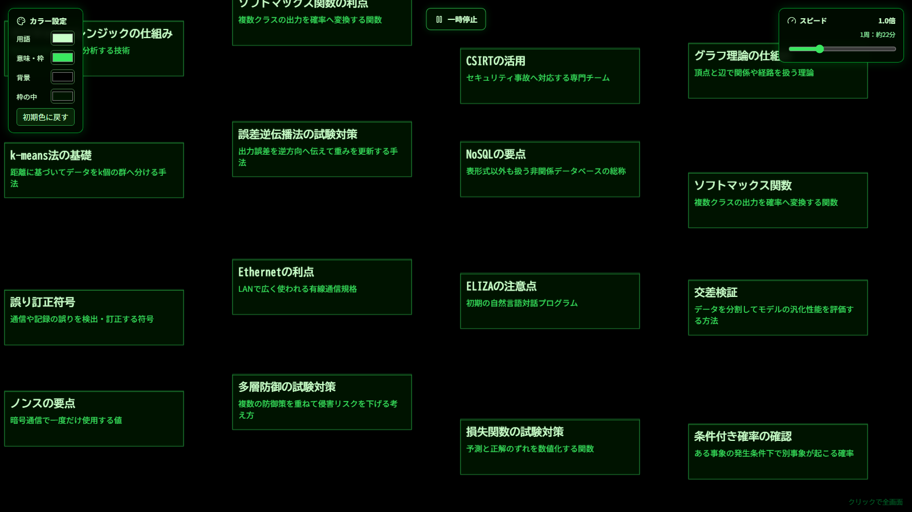

<p align="center">
  
</p>

<h1 align="center">情報処理・AI学習</h1>

<p align="center">
  応用情報技術者試験・G検定対策を、流れるカードで楽しく反復学習。
</p>

<p align="center">
  <strong>2,000項目</strong> ・ <strong>重複なし</strong> ・ <strong>1.0倍で約22分／周</strong>
</p>

<p align="center">
  <strong>日本語</strong> ・ <a href="README_EN.md">English</a>
</p>

<p align="center">
  <a href="https://oouchi1234567890.github.io/matrix-learning/"><strong>▶ 情報処理・AI学習を開く</strong></a>
  &nbsp;|&nbsp;
  <a href="https://oouchi1234567890.github.io/matrix-learning/index_en.html">Open English App</a>
</p>



##  このアプリについて

応用情報技術者試験やG検定に関連する情報処理・AIの学習項目を、マトリックス風のカードとして表示するブラウザアプリです。全2,000項目を一度ずつ表示してから再シャッフルするため、同じ周回内では内容が重複しません。

英語UIと英語コンテンツで学ぶ場合は、[English app](index_en.html)を開いてください。

##  学習分野

| アイコン | 分野 | 項目数 |
|:---:|---|---:|
|  | AI・G検定 | 700 |
|  | 応用情報・基礎技術 | 600 |
|  | セキュリティ | 300 |
|  | ネットワーク・DB・クラウド | 250 |
|  | 法務・倫理・マネジメント | 150 |
|  | **合計** | **2,000** |

##  主な機能

| アイコン | 機能 | 内容 |
|:---:|---|---|
|  | 重複防止 | 2,000項目を出し切ってから再シャッフル |
|  | 速度調整 | 0.25倍〜3.0倍。1周の予想時間も自動表示 |
|  | 一時停止 | 読みたいカードを現在位置で停止・再開 |
|  | 配色変更 | 用語・意味・枠・背景・カード内部を個別設定 |
|  | 全画面表示 | 学習画面をクリックして全画面へ切り替え |

##  クイックスタート

1. このリポジトリをダウンロードまたはcloneします。
2. `index.html`をブラウザで開きます。
3. 右上で速度を調整し、学習を始めます。

外部ライブラリのインストールやビルド作業は不要です。`index.html`と`knowledge.js`は同じフォルダに置いてください。

##  ドキュメント

- 画像付きの詳しい使い方：[操作ガイド](USER_GUIDE.md)
- English project page: [README_EN.md](README_EN.md)
- English user guide: [USER_GUIDE_EN.md](USER_GUIDE_EN.md)
- Lucideアイコンのライセンス：[Third-Party Notices](THIRD_PARTY_NOTICES.md)

## ファイル構成

```text
matrix-learning/
├─ index.html                 # 日本語版アプリ
├─ index_en.html              # 英語版アプリ
├─ knowledge.js               # 日本語学習データ
├─ knowledge_en.js            # 英語学習データ
├─ README.md                  # 日本語プロジェクト紹介
├─ README_EN.md               # 英語プロジェクト紹介
├─ USER_GUIDE.md              # 日本語画像付きガイド
├─ USER_GUIDE_EN.md           # 英語画像付きガイド
└─ docs/
   ├─ images/                # 操作画面
   └─ icons/                 # Lucide SVGアイコン
```
