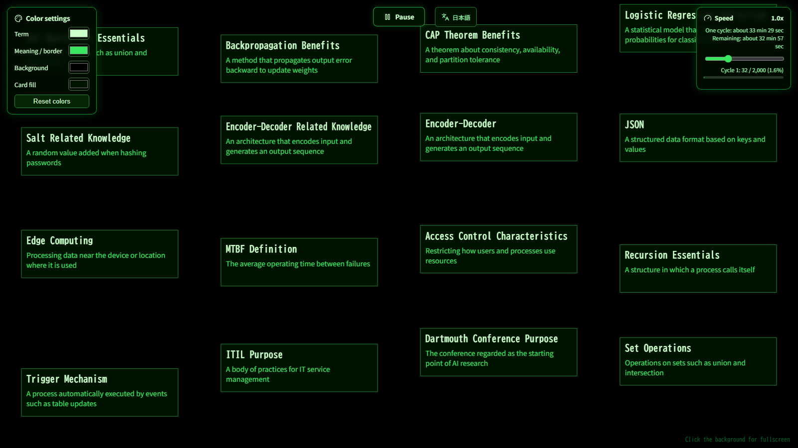

<p align="center">
  
</p>

<h1 align="center">IT &amp; AI Learning</h1>

<p align="center">
  Practice for Japan's Applied Information Technology Engineer Examination and the JDLA G Test with flowing study cards.
</p>

<p align="center">
  <strong>2,000 items</strong> · <strong>No repeats per cycle</strong> · <strong>Device-aware cycle and remaining time</strong>
</p>

<p align="center">
  <a href="README.md">日本語</a> · <strong>English</strong>
</p>

<p align="center">
  <a href="https://oouchi1234567890.github.io/matrix-learning/index_en.html"><strong>▶ Open IT &amp; AI Learning</strong></a>
  &nbsp;|&nbsp;
  <a href="https://oouchi1234567890.github.io/matrix-learning/">日本語版を開く</a>
</p>



##  About this app

This browser-based study app presents IT and AI concepts related to Japan's Applied Information Technology Engineer Examination and the JDLA G Test as Matrix-style flowing cards. All 2,000 items appear once before the deck is reshuffled, so an item never repeats within the same cycle.

Open the [English app](index_en.html) to study with an English interface and English content.

##  Study areas

| Icon | Area | Items |
|:---:|---|---:|
|  | AI & JDLA G Test | 700 |
|  | Applied IT & fundamentals | 600 |
|  | Security | 300 |
|  | Networking, databases & cloud | 250 |
|  | Law, ethics & management | 150 |
|  | **Total** | **2,000** |

##  Key features

| Icon | Feature | Description |
|:---:|---|---|
|  | No repeats | Reshuffles only after all 2,000 items have appeared |
|  | Speed control | Adjustable from 0.25× to 3.0× with an estimated cycle time |
|  | Cycle progress | Shows the cycle number, issued item count, percentage, and progress bar |
|  | Pause | Stops and resumes every card at its current position |
|  | Color settings | Customize terms, definitions, borders, page background, and card fill |
|  | Full screen | Click the study area to enter or leave full-screen mode |
|  | Mobile layout | Keeps controls and cards within the screen from 320px wide |

##  Quick start

1. Download or clone this repository.
2. Open `index_en.html` in a browser.
3. Adjust the speed in the upper-right corner and start studying.

No external libraries, package installation, or build step is required. Keep `index_en.html` and `knowledge_en.js` in the same directory.

##  Documentation

- Detailed illustrated instructions: [English User Guide](USER_GUIDE_EN.md)
- English creation prompt: [PROMPT_EN.md](PROMPT_EN.md)
- Japanese creation prompt: [PROMPT.md](PROMPT.md)
- Japanese project page: [README in Japanese](README.md)
- Lucide icon attribution: [Third-Party Notices](THIRD_PARTY_NOTICES.md)

## Project structure

```text
matrix-learning/
├─ index.html                 # Japanese app
├─ index_en.html              # English app
├─ knowledge.js               # Japanese study content
├─ knowledge_en.js            # English study content
├─ README.md                  # Japanese project page
├─ README_EN.md               # English project page
├─ USER_GUIDE.md              # Japanese illustrated guide
├─ USER_GUIDE_EN.md           # English illustrated guide
├─ PROMPT.md                  # Japanese creation prompt
├─ PROMPT_EN.md               # English creation prompt
└─ docs/
   ├─ images/                 # Screenshots
   └─ icons/                  # Lucide SVG icons
```
