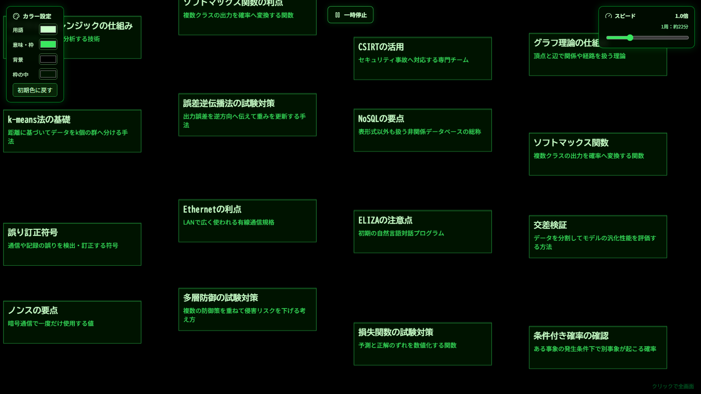

# 情報処理・AI学習 操作ガイド

「情報処理・AI学習」は、G検定・応用情報技術者試験などの学習項目を、流れるカードで眺めながら反復できるブラウザアプリです。インストールやビルドは必要ありません。

英語UIと英語学習コンテンツを使用する場合は、[English app](index_en.html)を開いてください。英語版の詳しい説明は[English User Guide](USER_GUIDE_EN.md)にあります。

> **学習項目は1周の中で重複しません。** 全2,000件を一度ずつ表示してから次の周へ進みます。速度を`1.0倍`に設定した場合、1周にかかる時間は約22分です。

## 目次

1. [起動方法](#起動方法)
2. [画面の見方](#画面の見方)
3. [色を変更する](#色を変更する)
4. [速度を変更する](#速度を変更する)
5. [一時停止・再開する](#一時停止再開する)
6. [全画面で表示する](#全画面で表示する)
7. [学習項目の表示ルール](#学習項目の表示ルール)
8. [GitHub Pagesで公開する](#github-pagesで公開する)
9. [困ったときは](#困ったときは)

## 起動方法

### ファイルから起動

1. `matrix-learning` フォルダを開きます。
2. `index.html` をダブルクリックします。
3. 既定のブラウザでマトリックス学習が表示されます。

`index.html` と `knowledge.js` は同じフォルダに置いてください。

### ローカルサーバーから起動

ローカルサーバーを利用する場合は、プロジェクトのルートを配信して `index.html` を開きます。Visual Studio CodeのLive Serverなども利用できます。

## 画面の見方

| 場所 | 機能 | 説明 |
|---|---|---|
| 左上 |  カラー設定 | 用語、意味・枠、背景、カード内部の色を変更します。 |
| 右上 |  スピード | カードが流れる速さを調整します。 |
| 上部中央 |  一時停止 | 表示を現在位置で停止し、同じボタンで再開します。 |
| 画面中央 | 学習カード | 上段に用語、下段に短い意味を表示します。 |
| 画面全体 |  全画面 | 操作パネル以外をクリックすると全画面表示を切り替えます。 |

## 色を変更する

 左上の「カラー設定」では、4種類の色を個別に変更できます。

- **用語**：カード上段の見出し色
- **意味・枠**：説明文とカード枠の色
- **背景**：画面全体の背景色
- **枠の中**：カード内部の背景色

色見本をクリックしてカラーピッカーを開き、好みの色を選択します。「初期色に戻す」を押すと、黒と緑を基調とした初期設定へ戻ります。

## 速度を変更する

 右上のスライダーを左右へ動かします。

- 最低速度：`0.25倍`
- 標準速度：`1.0倍`
- 最高速度：`3.0倍`
- 調整単位：`0.25倍`

倍率はスライダーの右上に表示され、変更はすぐカードの移動へ反映されます。

スライダーの上には、選択中の速度で2,000項目を一周するために必要な時間も表示されます。`1.0倍`では「1周：約22分」、`2.0倍`では「1周：約11分」のように自動更新されます。

スライダーの下には、現在の周回番号、表示済み件数、全2,000件に対する割合を進捗バーで表示します。例：`1周目：840 / 2,000（42.0%）`。2,000件を出し切ると、次の周回へ切り替わって進捗が先頭から始まります。

## 一時停止・再開する

 上部中央の「一時停止」を押すと、すべてのカードが現在位置で停止します。

- 停止中はボタンが「再開」に変わります。
- 「再開」を押すと、停止した位置から動き始めます。
- 用語を落ち着いて読みたいときに便利です。

## 全画面で表示する

 カラー設定・速度設定・一時停止ボタン以外の場所をクリックすると、全画面表示へ切り替わります。もう一度クリックすると解除されます。

ブラウザの制限によって全画面にならない場合は、ブラウザ側で全画面表示を許可してください。

## 学習項目の表示ルール

 全2,000件の学習項目をシャッフルし、同じ周回内では重複しないよう表示します。一度表示した項目は、その周回が終わるまで再び表示されません。

| 分野 | 項目数 |
|---|---:|
| AI・G検定 | 700 |
| 応用情報・基礎技術 | 600 |
| セキュリティ | 300 |
| ネットワーク・DB・クラウド | 250 |
| 法務・倫理・マネジメント | 150 |
| **合計** | **2,000** |

2,000件をすべて表示すると、再度シャッフルして次の周回を開始します。速度を`1.0倍`に設定した場合、1周にかかる時間は約22分です。

## GitHub Pagesで公開する

1. `matrix-learning` の内容をGitHubリポジトリへpushします。
2. GitHubのリポジトリで **Settings** → **Pages** を開きます。
3. **Build and deployment** のSourceで **Deploy from a branch** を選択します。
4. 公開するブランチとルートフォルダを選び、保存します。
5. 発行されたURLへアクセスして動作を確認します。

`index.html` がリポジトリのルートにある構成が最も簡単です。

## 困ったときは

### カードが表示されない

- `index.html` と `knowledge.js` が同じフォルダにあるか確認してください。
- ブラウザを再読み込みしてください。
- 開発者ツールのConsoleにエラーがないか確認してください。

### 右端のカードが切れる

最新版では画面幅に合わせて列数とカード幅を再計算します。古いファイルを表示している場合は、キャッシュを無視して再読み込みしてください。

### 動きが速すぎる

右上の速度を下げるか、上部中央の「一時停止」を使用してください。

### 色を元へ戻したい

左上の「初期色に戻す」を押してください。

---

画面内と本ガイドの操作アイコンには、[Lucide](https://lucide.dev/)のアイコンを使用しています。
