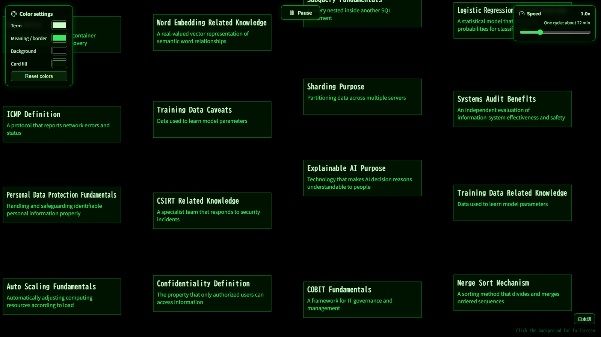

# IT & AI Learning — User Guide

IT & AI Learning is a browser-based app for reviewing concepts from Japan's Applied Information Technology Engineer Examination, the JDLA G Test, and related fields through flowing study cards. It requires no installation or build step.

<a href="USER_GUIDE.md">日本語の操作ガイド</a> · <strong>English User Guide</strong>

> **Items do not repeat within a cycle.** The app displays each of the 2,000 study items once before starting the next cycle. At `1.0×`, one complete cycle takes approximately 22 minutes.

## Contents

1. [Starting the app](#starting-the-app)
2. [Screen layout](#screen-layout)
3. [Changing colors](#changing-colors)
4. [Changing the speed](#changing-the-speed)
5. [Pausing and resuming](#pausing-and-resuming)
6. [Using full-screen mode](#using-full-screen-mode)
7. [Using the app on a smartphone](#using-the-app-on-a-smartphone)
8. [How study items are displayed](#how-study-items-are-displayed)
9. [Publishing with GitHub Pages](#publishing-with-github-pages)
10. [Troubleshooting](#troubleshooting)

## Starting the app

### From local files

1. Open the `matrix-learning` folder.
2. Double-click `index_en.html`.
3. The English version opens in your default browser.

Keep `index_en.html` and `knowledge_en.js` in the same directory.

### From a local server

Serve the project root and open `index_en.html`. A simple development server, such as Visual Studio Code Live Server, works well.

To use the Japanese version instead, open `index.html`.

## Screen layout

| Location | Control | Description |
|---|---|---|
| Upper left |  Color settings | Changes the term, definition/border, page background, and card fill colors. |
| Upper right |  Speed | Adjusts how quickly the cards move. |
| Top center |  Pause | Freezes every card at its current position; press again to resume. |
| Main area | Study cards | Shows a term on the first line and a short definition below it. |
| Study area |  Full screen | Click outside the control panels to toggle full-screen mode. |

## Changing colors

 The **Color Settings** panel in the upper-left corner lets you customize four colors independently:

- **Term** — heading text on each card
- **Definition & border** — definition text and card border
- **Background** — the page background
- **Card fill** — the background inside each card

Click a color swatch and choose a color. Select **Restore Defaults** to return to the original black-and-green palette.

## Changing the speed

 Move the slider in the upper-right corner.

- Minimum: `0.25×`
- Default: `1.0×`
- Maximum: `3.0×`
- Step: `0.25×`

The selected multiplier appears above the slider and takes effect immediately. The panel also estimates the time needed to show all 2,000 items at the selected speed. For example, it shows approximately 22 minutes at `1.0×` and approximately 11 minutes at `2.0×`.

Below the slider, a progress bar shows the current cycle number, issued item count, and percentage of all 2,000 items—for example, `Cycle 1: 840 / 2,000 (42.0%)`. After all items have appeared, the next cycle starts from the beginning with a newly shuffled order.

## Pausing and resuming

 Select **Pause** at the top center to stop every card at its current position.

- The button changes to **Resume** while paused.
- Selecting **Resume** continues from the same positions.
- Pause when you want more time to read a definition.

## Using full-screen mode

 Click anywhere outside the color, speed, and pause controls to enter full-screen mode. Click the study area again to leave it.

If full-screen mode does not start, allow full-screen access in your browser.

## Using the app on a smartphone

At widths of 600px or less, the color and speed panels become compact, while Pause and the language switch move to the bottom of the screen. Cards are drawn below the top controls and automatically sized so neither edge is clipped. Portrait layouts are supported from 320px wide.

## How study items are displayed

 The app shuffles all 2,000 items and prevents repeats within the current cycle. Once an item has appeared, it cannot appear again until the cycle is complete.

| Area | Items |
|---|---:|
| AI & JDLA G Test | 700 |
| Applied IT & fundamentals | 600 |
| Security | 300 |
| Networking, databases & cloud | 250 |
| Law, ethics & management | 150 |
| **Total** | **2,000** |

After all 2,000 items have appeared, the app reshuffles the deck and begins a new cycle. At `1.0×`, a complete cycle takes approximately 22 minutes.

## Publishing with GitHub Pages

1. Push the contents of `matrix-learning` to a GitHub repository.
2. In the repository, open **Settings** → **Pages**.
3. Under **Build and deployment**, choose **Deploy from a branch**.
4. Select the branch and root folder to publish, then save.
5. Open the generated URL and verify the app.

GitHub Pages serves `index.html` by default. To make English the default landing page, either rename `index_en.html` to `index.html` in an English-only deployment or add a clear language link from the Japanese landing page.

## Troubleshooting

### No cards appear

- Confirm that `index_en.html` and `knowledge_en.js` are in the same directory.
- Reload the browser page.
- Check the browser developer console for errors.

### A card is clipped at the right edge

The current version recalculates its column count and card width for the viewport. If an older layout appears, reload while bypassing the browser cache.

### Cards move too quickly

Lower the speed in the upper-right corner, or select **Pause** at the top center.

### I want to restore the original colors

Select **Restore Defaults** in the upper-left color panel.

---

The interface and this guide use icons from [Lucide](https://lucide.dev/).
